# Conexión remota y carpeta compartida entre Windows y Kali Linux (SSH + Samba)

Laboratorio práctico en el que administro una máquina virtual de **Kali Linux** desde **Windows** por **SSH** (con PuTTY) y comparto una carpeta con **Samba** para intercambiar archivos en ambos sentidos.

**Autor:** Diego Ledezma

## Qué logré

- Conectarme por SSH desde Windows a una VM de Kali (VirtualBox) y ejecutar comandos de forma remota.
- Configurar Samba desde cero: `smb.conf`, recurso compartido, usuario y permisos.
- Abrir la carpeta compartida desde el explorador de Windows y comprobar la transferencia **Windows → Kali** y **Kali → Windows**.
- Diagnosticar y resolver cuatro problemas reales (documentados al final).

## Entorno

| Componente | Detalle |
|---|---|
| Equipo anfitrión | Windows con PuTTY |
| Servidor | Kali Linux en VirtualBox (VM) |
| Red de la VM | Adaptador puente (IP de ejemplo: `192.168.68.62`) |
| Servicios | OpenSSH (`ssh`) y Samba (`smbd`, `nmbd`) |

> Las IPs de este documento son de una red local de práctica.

---

## Parte 1: SSH con PuTTY (Windows → Kali)

### 1. Poner la VM en adaptador puente

En VirtualBox, con la VM **apagada**: *Configuración → Red → Adaptador 1 → Conectado a: Adaptador puente* (tarjeta de red real).

Con **NAT** la VM obtiene la IP `10.0.2.15`, que Windows no puede alcanzar. Después del cambio hay que **apagar la VM por completo y volver a iniciarla** para que tome una IP de la red real.

En Kali, verifica la IP:

```bash
ip a
```

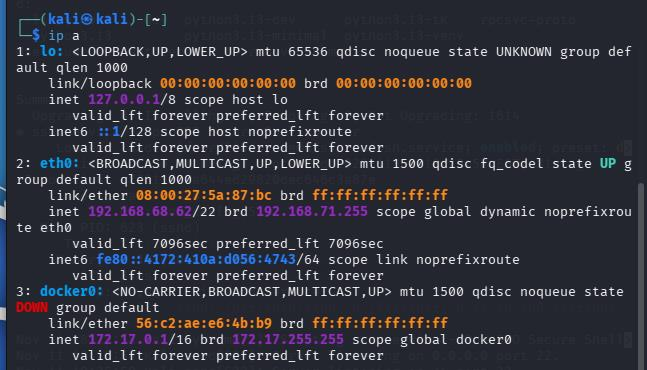

### 2. Activar el servicio SSH en Kali

En Kali, SSH viene desactivado. Sin esto, PuTTY responde `Connection refused`.

```bash
sudo systemctl enable --now ssh
```

### 3. Conectarse con PuTTY

PuTTY es un cliente SSH gratuito para Windows. Se instala con las opciones por defecto.

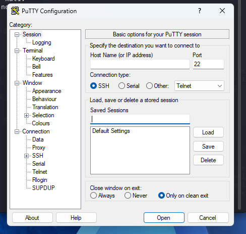

En **Host Name** va la IP de Kali, el puerto es **22** (el predeterminado de SSH) y el tipo de conexión es **SSH**.

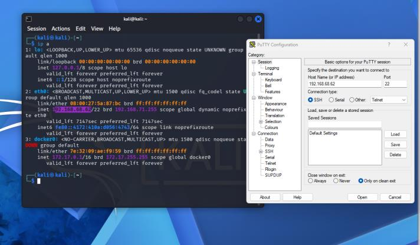

Al pulsar **Open** aparece una alerta de huella del servidor la primera vez: se acepta con **Accept**. Luego se inicia sesión con el usuario `kali` y su contraseña (al escribirla no se ve nada). El prompt `└─$` indica que la conexión funciona.

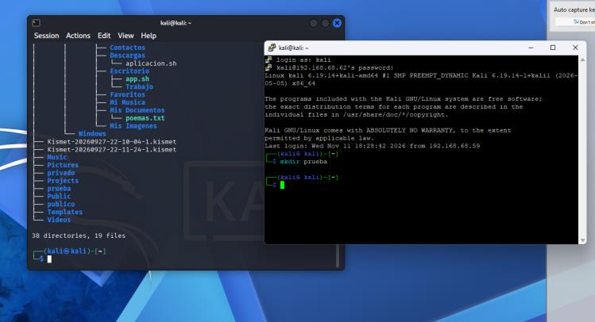

### 4. Comandos de prueba

```bash
whoami
pwd
mkdir prueba
cd prueba
touch pruebadePutty.txt
tree
```

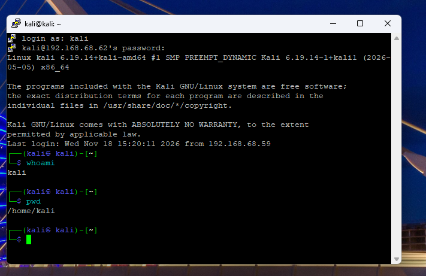

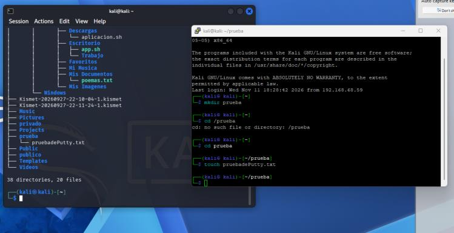

- `whoami`: usuario con el que estoy conectado (`kali`).
- `pwd`: carpeta actual.
- `mkdir`: crea una carpeta. `cd /prueba` falla porque la ruta con `/` parte desde la raíz; con `cd prueba` funciona.
- `touch`: crea un archivo vacío. `tree`: muestra la estructura de carpetas.

---

## Parte 2: Samba (carpeta compartida con Windows)

### 5. Instalar Samba y arrancar el servicio

```bash
sudo apt update
sudo apt install samba -y
sudo systemctl start smbd
systemctl status smbd
```

En Kali el servicio queda `disabled` e `inactive` tras instalar; es normal. Para que además arranque con el sistema (y para levantar `nmbd`):

```bash
sudo systemctl enable --now smbd nmbd
```

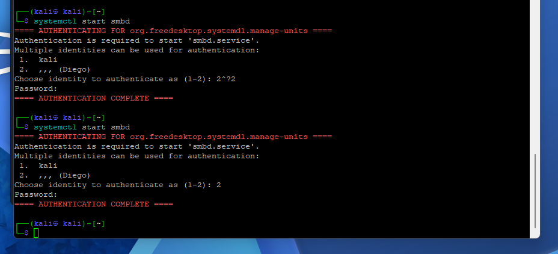

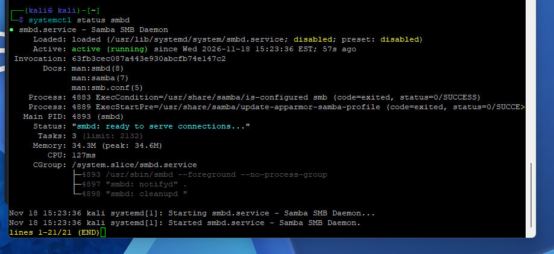

### 6. Configuración global: `/etc/samba/smb.conf`

Una opción por línea:

```ini
[global]
server string = File Server
workgroup = SO
security = user
map to guest = Bad User
name resolve order = bcast host
include = /etc/samba/shares.conf
```

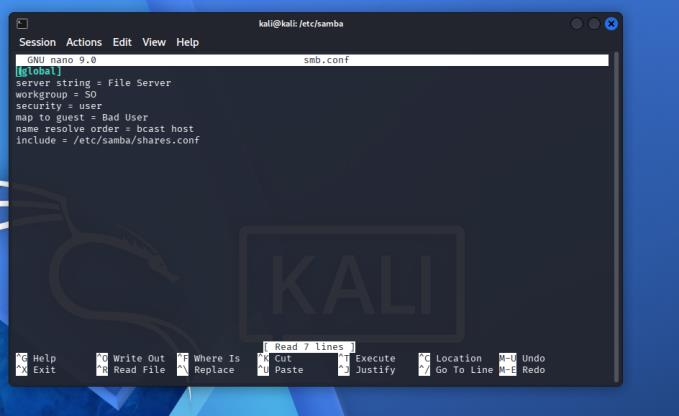

### 7. Recurso compartido: `/etc/samba/shares.conf`

```ini
[Public]
path = /share/public_files
force user = smbuser
force group = smbgroup
create mask = 0664
force create mode = 0664
directory mask = 0775
force directory mode = 0775
public = yes
writable = yes
```

El recurso se llama `[Public]` **sin espacios** (ver problema 3). La captura siguiente muestra la versión inicial, cuando todavía se llamaba `[Public Files]`:

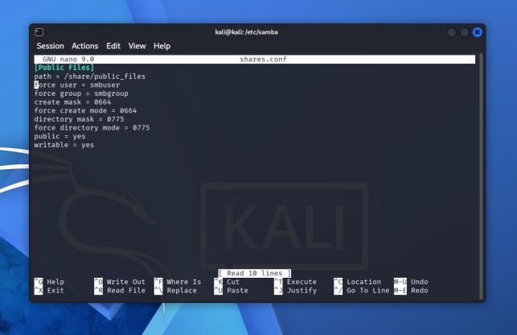

Para renombrarlo:

```bash
sudo sed -i 's/^\[Public Files\]/[Public]/' /etc/samba/shares.conf
```

Revisar la configuración (no debe dar errores) y reiniciar:

```bash
testparm -s
sudo systemctl restart smbd
```

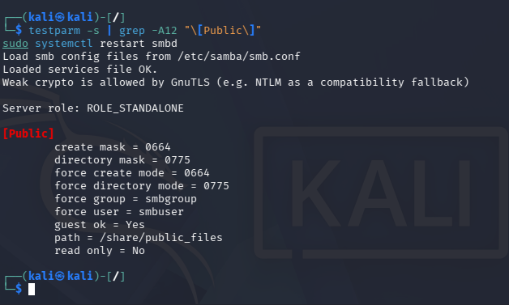

### 8. Usuario y permisos de la carpeta

El usuario `smbuser` (grupo `smbgroup`) debe existir y ser dueño de `/share/public_files` con permisos `rwxrwxr-x`:

```bash
id smbuser
ls -ld /share/public_files
```

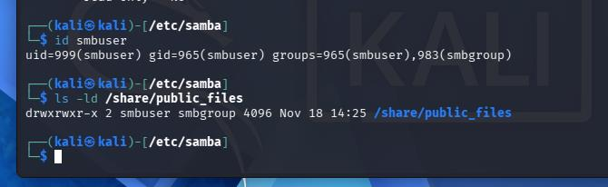

<details>
<summary>Referencia para crearlos desde cero (no probado en esta práctica; ya existían en mi laboratorio)</summary>

```bash
sudo groupadd smbgroup
sudo useradd -M -s /usr/sbin/nologin -g smbgroup smbuser
sudo mkdir -p /share/public_files
sudo chown smbuser:smbgroup /share/public_files
sudo chmod 775 /share/public_files
```

</details>

Qué hace cada opción de `shares.conf`:

| Opción | Efecto |
|---|---|
| `public = yes`, `writable = yes` | Permiten entrar y escribir |
| `force user`, `force group` | Todo se guarda como `smbuser:smbgroup` |
| `create mask = 0664`, `directory mask = 0775` | Permisos de archivos y carpetas nuevos |

Además hay que crear el usuario dentro de Samba, con una contraseña **distinta** a la de Kali. Sin este paso, Windows bloquea el acceso:

```bash
sudo smbpasswd -a kali
```

### 9. Acceder desde Windows

En CMD se limpian las conexiones guardadas y luego se abre el recurso con `Win + R`:

```bat
net use * /delete
\\192.168.68.62\Public
```

Se inicia sesión con el usuario `kali` y la contraseña de **Samba**.

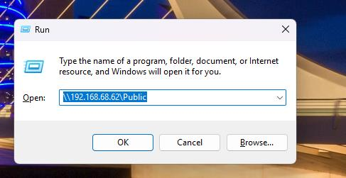

### 10. Pruebas en ambos sentidos

**Windows → Kali.** Copié un archivo de Word a la carpeta `Public` y en Kali comprobé que llegó (los nombres de archivo ajenos a la práctica están tapados):

```bash
ls -l /share/public_files
```

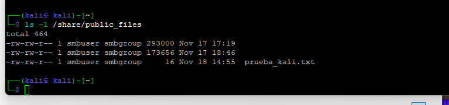

**Kali → Windows.** Creé un archivo de prueba en Kali. Como se creó con `sudo` quedó como `root`, así que hay que cambiar el dueño y los permisos para que Samba lo muestre:

```bash
echo "hola desde kali" | sudo tee /share/public_files/prueba_kali.txt
sudo chown smbuser:smbgroup /share/public_files/prueba_kali.txt
sudo chmod 664 /share/public_files/prueba_kali.txt
```

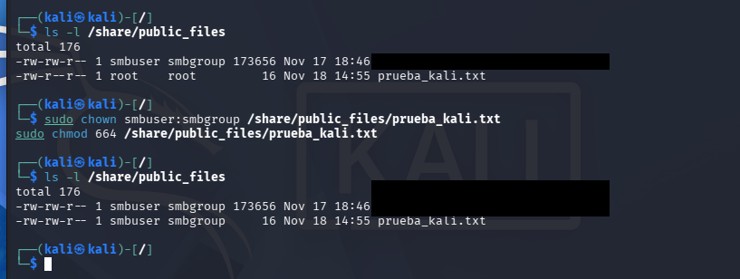

**Resultado.** Al volver a abrir la carpeta en Windows aparece `prueba_kali.txt` junto con el archivo de Word: el intercambio funciona en los dos sentidos.

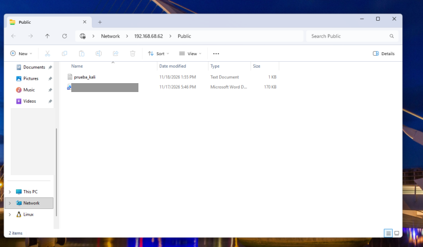

---

## Problemas encontrados y cómo los resolví

| # | Problema | Causa | Solución |
|---|---|---|---|
| 1 | PuTTY: `Connection refused` | SSH inactivo en Kali y VM en NAT (`10.0.2.15`, inalcanzable desde Windows) | `sudo systemctl enable --now ssh`, adaptador puente y reinicio completo de la VM (nueva IP `192.168.68.62`) |
| 2 | Samba no arrancaba: `Error loading services` | Dos líneas de `smb.conf` (`map to guest` y `name resolve order`) quedaron pegadas | Separarlas con `nano` y validar con `testparm -s` |
| 3 | Windows no entraba a la carpeta | (a) mi usuario no existía en Samba y Windows bloqueaba el acceso de invitados; (b) el nombre `Public Files` con espacio hacía que Windows cortara la ruta | (a) `sudo smbpasswd -a kali`; (b) renombrar la sección a `[Public]` |
| 4 | El archivo creado en Kali no aparecía en Windows | Quedó como `root:root` por usar `sudo`, y Windows tenía en caché la lista vieja | `chown` + `chmod` y `net use * /delete` |

## Conceptos clave

- **PuTTY vs. Samba.** PuTTY sirve para *manejar* un equipo remoto desde una terminal; Samba sirve para *compartir archivos*.
- **Por qué hace falta el servicio SSH.** PuTTY solo inicia la llamada; en Kali tiene que haber un servicio SSH escuchando en el puerto 22. Sin él, el resultado es `Connection refused`.
- **Protocolo de Samba.** SMB, el mismo que usa Windows para compartir carpetas; por eso se abre desde el explorador sin instalar nada.
- **Seguridad.** Esta configuración (`public = yes`, invitados permitidos) es solo para un laboratorio. En un servidor real conviene exigir usuario y contraseña, restringir con `valid users` y dar a cada persona solo los permisos que necesita.
- **Uso real.** SSH permite a TI revisar o arreglar servidores Linux sin ir al equipo; Samba permite que empleados con Windows guarden y compartan documentos en un servidor Linux.

## Aprendizajes

1. Para que SSH funcione hacen falta dos cosas: el servicio activo y una red de la VM alcanzable (en este caso, adaptador puente).
2. Con Samba no basta con instalarlo: hay que validar la configuración con `testparm`, crear el usuario de Samba y ajustar los permisos; un espacio en un nombre o un archivo de `root` basta para que falle.
3. Cada error se resolvió leyendo el mensaje y revisando servicios, usuarios, permisos y red, que es el método de trabajo de un administrador de sistemas.
